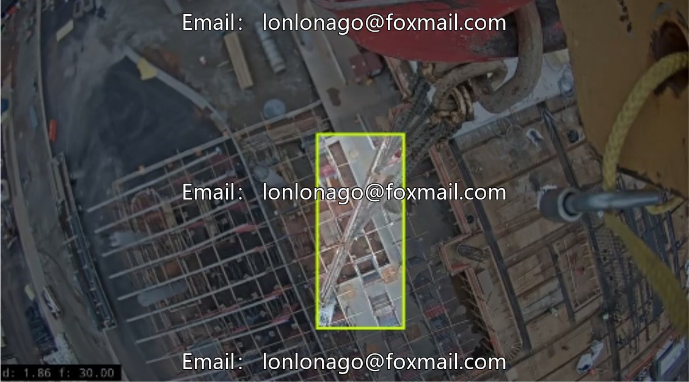
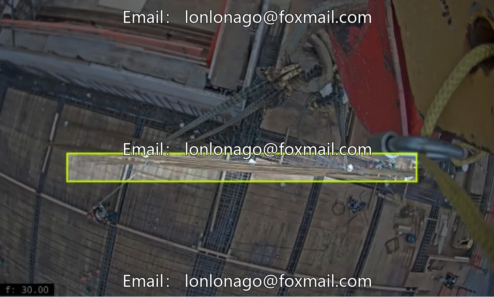
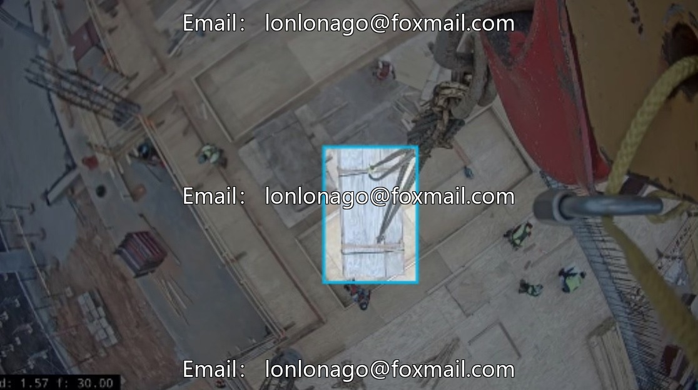
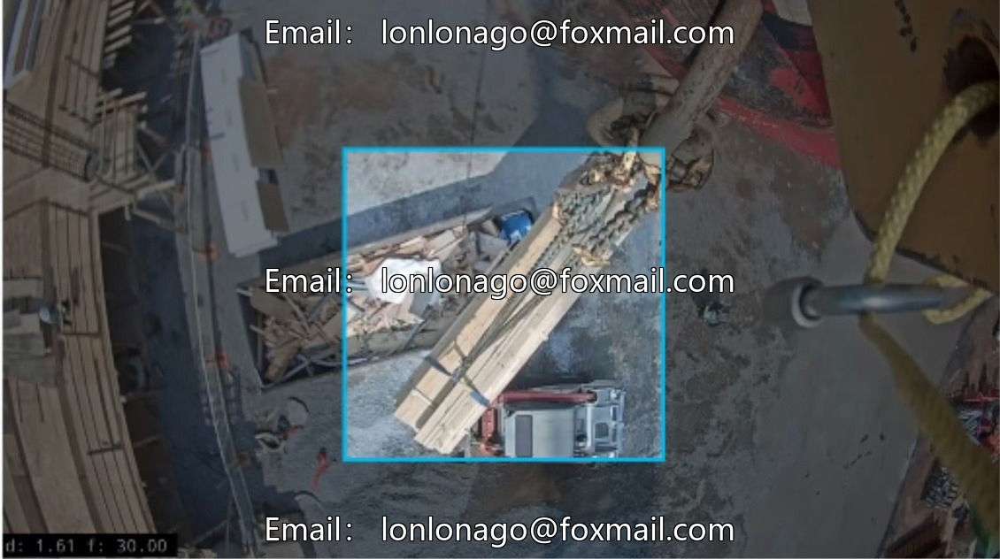
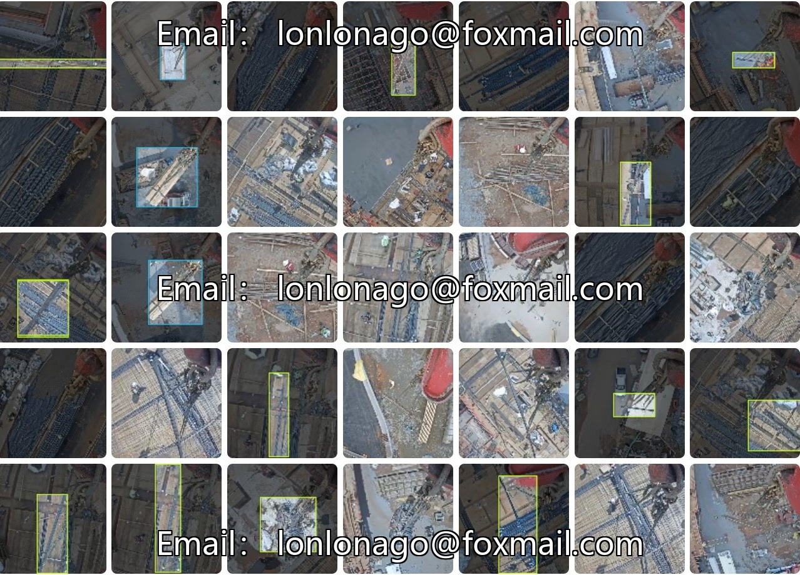
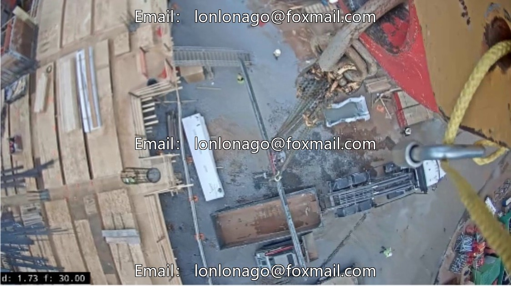

# Smart Agriculture Construction Site Material Identification Dataset, including wood piles, tower cranes, steel, and glued timber.

## Body

Intelligent Agriculture Construction Site Material Identification Dataset, including identification of timber stacks, tower cranes, steel, plywood, sandbags, etc., from a drone perspective, issue 10266

Dataset Category: Target Detection Computer Vision Dataset, including four core categories of plywood, wood, rebar, and sandbags.
Data Quantity: 2200 images, suitable for training basic target detection models.
Format Explanation: Image files are the main format, supporting image file upload to test model effectiveness.
Core Applications: Building construction scene material recognition, on-site safety supervision, intelligent upgrading of construction process.

Virtual materials, once sold, are non-refundable.
Interested friends, click "I want" to proceed.

## Images

## Payment

Here is a pay link on Stripe ( https://buy.stripe.com/3cs8yP7sY87d0vu9AB ). Please contact me lonlonago@foxmail.com after funding $89, and I will send you a complete data files , thank you!

